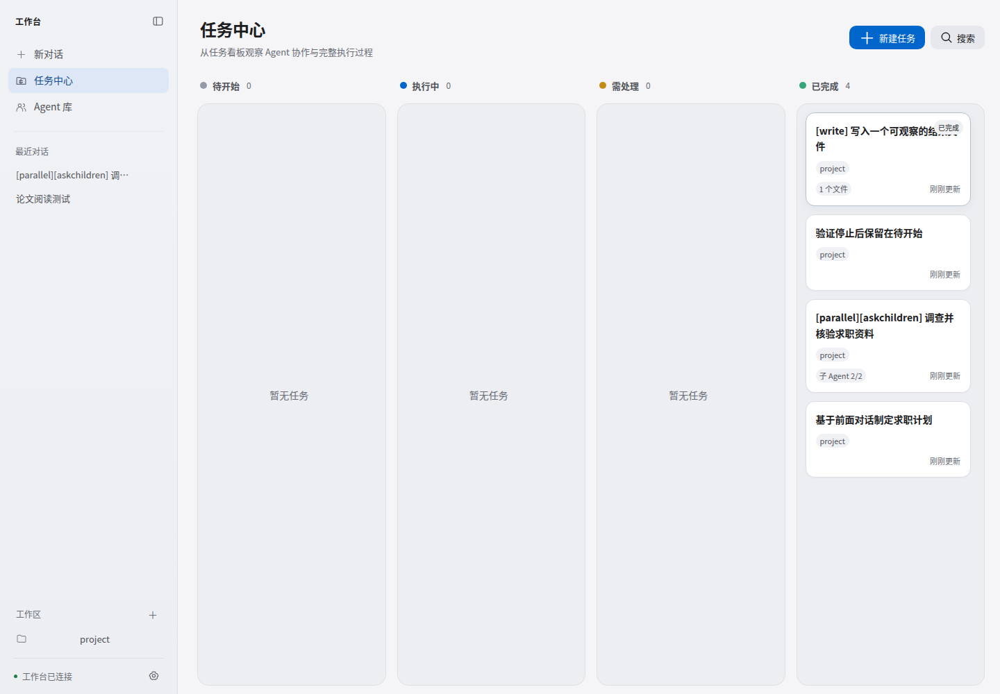

# Pi Agent Workbench

一个运行在 WSL/Linux 上的本地 Agent 工作台。Python 管理任务、审批和数据，Pi 负责模型与工具执行，浏览器展示对话、协作过程和交付结果。

适合用来观察长任务：谁在执行、调用了什么工具、哪里需要补充信息，以及最终交付了哪些文件。



## 运行

需要 Python 3.11+ 和可用的 Pi。本项目当前以 Pi 1.3.0 验证，启动前先完成 Pi 的模型授权。

```bash
git clone https://github.com/xinyking/pi-agent-workbench-demo.git
cd pi-agent-workbench-demo
python3 -m venv .venv
source .venv/bin/activate
python -m pip install 'pypdf>=6,<7'

pi --version
./run.sh --port 4310
```

打开 [localhost:4310](http://localhost:4310)。在设置中添加项目目录、选择模型，然后新建对话或任务。Pi 不在 PATH 时，用 `WORKBENCH_PI=/path/to/pi ./run.sh --port 4310` 指定路径。

本机状态默认保存在 `.workbench/`。多个实例需要使用不同端口和数据目录，例如 `./run.sh --port 4312 --data .workbench-test/state.sqlite3`。

## 能做什么

- **任务与协作**：普通对话、任务规划、一层子 Agent 委派、停止与继续，支持并行执行和人工补充信息。
- **执行记录**：按轮次查看模型、工具、记忆组装与审批过程，检查工具结果、文件差异和任务归档。
- **资料与上下文**：读取文字型 PDF、DOCX、Markdown；选择消息或文档片段交接，保存任务约束与可确认的长期记忆。
- **模型与执行器**：配置 API 连接和 Agent 独立模型；可选调用已安装的 Codex / Claude CLI。
- **评测与成本**：独立报告页展示业务审阅、请求、工具、错误、成功率和估算金额；可查询 DeepSeek 官方余额。

文件修改和命令执行经过工作台审批。Shell 使用本机用户权限；任务工作区不是操作系统沙箱。

## 代码怎么找

```text
workbench/
  __main__.py           服务入口
  runtime.py            任务执行与协作
  store.py              SQLite 与事件记录
  conversations.py      普通对话
  context/              任务上下文、约束、来源和记忆
  models/               Pi 连接、模型目录与 API 配置
  ops/                  评测、用量、计费和交付归档
  web/                  HTTP 路由与 SSE
  pi/                   Pi 扩展与工具桥接
  static/
    index.html
    js/                 页面控制器与视图逻辑
    css/                界面样式
    vendor/             随项目分发的前端依赖

.pi/agents/             内置 Agent 定义
evals/                  隔离用例与独立评分器
tests/                  Python / JavaScript 回归与离线样本
scripts/                评测和浏览器验证入口
```

界面使用原生 JavaScript 和 CSS，没有前端构建步骤。模块组织参考了 [Waku](https://github.com/shenseanchen/waku-agent) 对运行、记忆和运维代码的划分；Agent 执行仍使用 Pi RPC。

## 验证

```bash
make test
# 或分别运行
python -m unittest discover -s tests -q
node --test tests/test_*.mjs
```

部分集成测试需要额外依赖，未配置时会跳过。浏览器验证使用临时工作区和数据库，不写入日常使用的数据：

```bash
python -m pip install playwright
python -m playwright install chromium
python scripts/verify_ui.py --desktop-only
```

离线评测入口是 `scripts/run_evals.py`，默认只列计划。可选的 DeepEval 环境安装在单独虚拟环境中：

```bash
python3 -m venv .venv-evals
.venv-evals/bin/pip install -r evals/requirements.lock
.venv-evals/bin/python scripts/run_deepeval.py --mode offline --judge contract \
  --output artifacts/evals/local-check
```

`contract` 使用合成裁判验证评分流程，不代表真实模型质量。评测输出目录必须不存在。

## 当前边界

项目面向个人本机使用。OCR、语义检索、通用故障恢复仍有缺口；在线任务质量取决于模型与输入资料，离线回归通过不能说明系统带来质量提升。

成本按可用用量与价格信息估算，缺失部分显示未知。DeepSeek 余额是账户数据，不能当作单任务账单；独立重复样本不足时不计算稳定性和方差。界面截图使用示例任务，不包含真实用户数据。
