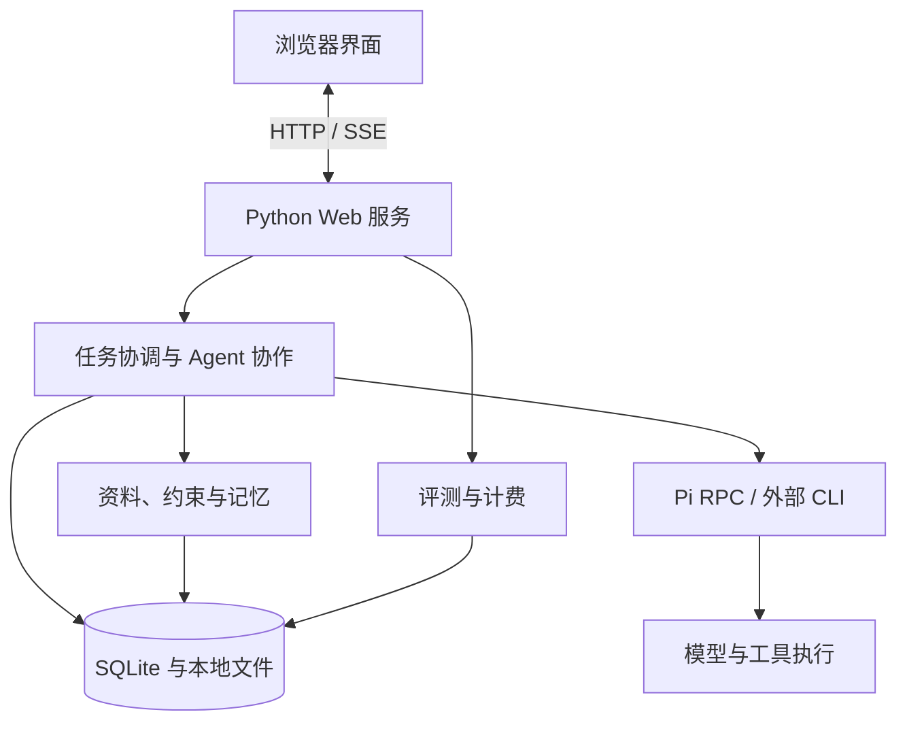

# Pi Agent Workbench

我希望在把任务交给 Agent 之后，仍然能看清整个过程：它现在做到了哪一步，调用过什么工具，为什么需要我介入，最后交付了什么。

这个工作台就是围绕这些问题做的。它把 Pi 的任务执行接到一个本地 Web 界面里，提供任务看板、对话、多 Agent 协作、执行轨迹、上下文管理和评测报告。Python 负责协调与持久化，Pi 负责模型和工具执行，浏览器负责把过程展示出来。

如果你也想观察 Agent 如何完成一件事，或者正在研究工具、上下文和评测怎样配合，希望这个项目能提供一个可以运行、可以追踪的例子。

[任务中心](#先从任务中心看起) · [评测报告](#任务结束后再看效果与代价) · [架构](#架构)

### 先从任务中心看起

任务按“待开始、执行中、需处理、已完成”排列。一个任务的进度、子 Agent 数量和文件变化可以在卡片上看到，点进去再看具体过程。

我希望“需处理”是一个有用的入口：缺了资料、需要审批、执行中断，都应该有明确提示，让人知道下一步该做什么。

新建任务时可以选择工作区、模型和执行器。普通讨论留在对话里，需要真正操作文件或分派子任务时，再转入任务流程。任务支持停止、补充要求和继续执行。

### 展开轨迹，看看时间花在哪里

任务详情默认打开执行轨迹。模型响应、工具调用、记忆组装和审批等待放在一条时间轴上，方便找到耗时的位置，以及失败发生前的上下文。

点开一条记录，可以继续查看已采集的参数、结果和关联信息；可以按 Agent 和执行轮次查看任务记录；对话轨迹还支持事件类型筛选，避免长任务的记录混在一起。

这里展示的是可观察的执行事件。缺少开始时间、用量或价格信息时会保留未知状态，不补造完整记录。模型调用结束也不会自动等同于业务验收通过。

### 看清主 Agent 和子 Agent 如何协作

概览里的流程图根据实际事件生成，可以看到主 Agent 的分析、委派、子 Agent 执行和汇总过程。点击节点能查看相应记录，遇到中断时也能沿着流程回到问题所在。

目前支持一层子 Agent 委派，以及同一批次内的并行执行。内置角色包括调查、执行、审查和测试，也可以在 Agent 库中修改角色提示词、可用工具和模型。

角色拆分提供了观察和控制协作的方式；它是否提高任务质量，仍然需要在相同任务与预算下验证。

### 把目标、约束和资料放在能找回的地方

任务过程中经常会积累新的要求和决定。我希望这些内容有明确归属，也能在后续调用前检查到底注入了哪些信息。

“上下文与记忆”保存任务目标、用户约束和 Agent 工作笔记，并记录最近的组装快照。用户约束与 Agent 笔记分别展示；长期记忆的读取、写入和清理可以独立控制。

资料入口支持文字型 PDF、DOCX 和 Markdown。创建任务时，可以选择聊天消息、文档页或文本块，预览准备交接的内容与初始预算。较长的工具结果可以外置保存，再按需要取回原文。

目前的初始预算使用保守的字节检查，不是全执行循环的精确 Token 预算。扫描件 OCR 和语义检索还没有实现。

### 任务结束后，再看效果与代价

评测报告是独立页面。上方汇总请求、工具调用、估算金额和策略拦截，下方按任务对比运行状态、业务结论、步数、工具成功率和费用。

我更关心一份结论能解释到什么程度，所以页面把“执行完成”和“业务评测”分开，也保留缺证据、未评测和待重评的情况。

| 信息 | 看它是为了什么 |
| --- | --- |
| 业务结论与分项理由 | 检查需求是否满足、交付是否完整、依据是否充分 |
| 请求次数与步数 | 观察已采集的模型调用和执行轮次 |
| 工具调用、失败与成功率 | 检查工具执行结果，并保留未知或未返回的结果 |
| 系统错误 | 定位运行问题，和工具失败分别记录 |
| 估算金额与未知部分 | 了解成本及计价覆盖范围 |
| 策略拦截与审批拒绝 | 查看已记录的边界控制，不能据此认定没有安全违规 |
| 重复成功率与方差 | 仅在有同条件独立重复样本时计算；当前不足则明确提示 |

点击“查看评测”，同一页面会展开所选任务的分项结论、理由、运行检查和计价依据，也能回到任务轨迹继续核对。

当前的业务审阅来自已保存的事后证据检查，并不是每个任务都会自动得到模型裁判评分。任务出现新的执行事件后，旧结论会标为“待重评”。

DeepSeek 官方账户区支持手动查询可用余额、充值余额和赠金。任务只显示一个“估算金额”：优先使用可用的官方人民币价格快照，否则回退已有模型估算并注明币种。余额属于账户，不能通过余额差认定单个任务的实际扣费。

## 架构

Python 负责协调任务、审批和事件记录，Pi 承担模型与工具执行。上下文、模型接入和评测分别放在 `context/`、`models/`、`ops/`；前端使用原生 JavaScript 和 CSS，通过 SSE 接收执行进度。
