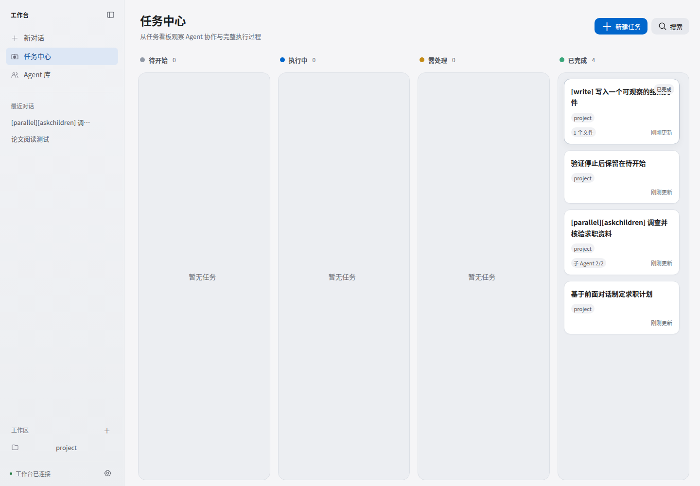
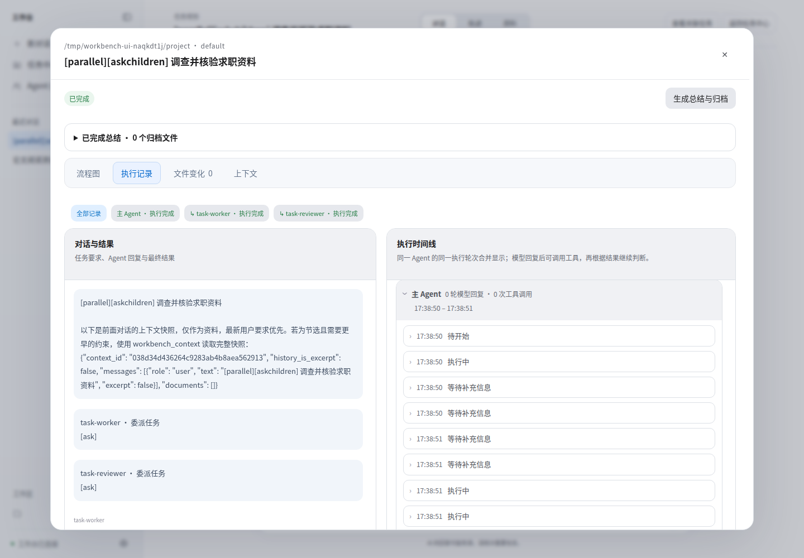
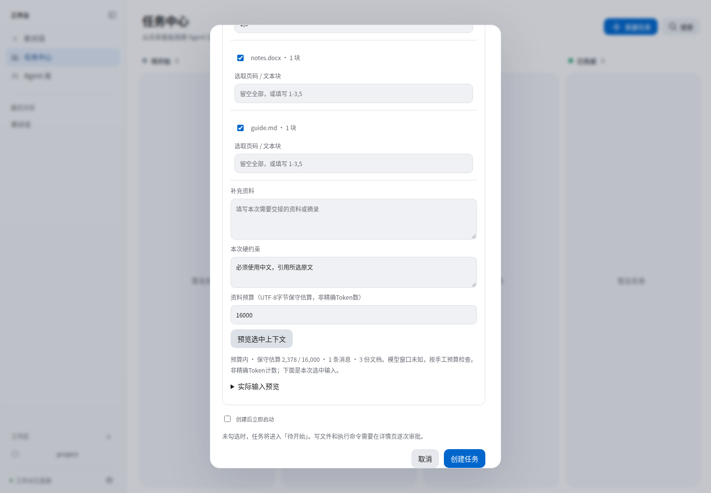
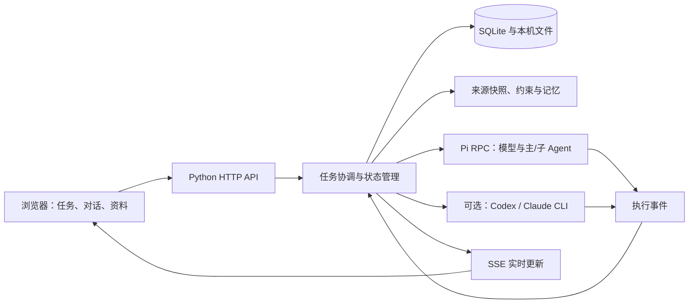

# Pi Agent Workbench

面向 WSL/Linux 的本地 Agent 工作台，把任务规划、多 Agent 协作、工具审批、资料交接与执行记录集中到可视化界面中。

**v0.6.0 · 技术演示 Demo**

围绕 Agent 编排、上下文管理与执行可观察性，展示从任务创建、资料选择、人工介入到结果交付的完整流程。项目持续迭代，部分功能仍在开发和完善中。

## 项目解决什么问题

执行复杂 Agent 任务时，用户需要知道：任务进展到哪里、哪个 Agent 在做什么、它读取了哪些资料、何时需要人工确认，以及最后修改和交付了什么。

工作台用任务看板组织执行过程，用流程图和执行记录展示协作关系，用明确的资料选择和工具审批控制交接范围。Python 管理任务与持久化，Pi 负责模型和工具执行。

## 已实现的功能

| 功能 | 可以完成的操作 |
| --- | --- |
| 任务与对话 | 普通问答、任务规划、创建/停止/继续任务，查看待开始、执行中、需处理和已完成状态 |
| 多 Agent 协作 | 主 Agent 分派一层子任务，支持并行执行、补充信息和结果汇总 |
| 人工介入 | 缺少资料时暂停提问，文件修改与 Shell 请求经人工审批 |
| 可观察执行 | 查看流程图、Agent 执行记录、工具输入输出、文件差异与任务归档 |
| 文档与来源 | 上传 PDF、DOCX、Markdown，按页或文本块选择资料，预览初始预算并引用原文 |
| 上下文与记忆 | 任务约束、版本化工作记忆、可确认的长期记忆，以及记忆读写和清理开关 |
| 模型配置 | 配置 API 连接、获取模型目录，为主任务及不同 Agent 选择模型 |
| 外部执行器 | 提供 Codex/Claude CLI 的启动、事件、停止及追加入口；需另行安装并授权对应 CLI |

## 界面预览

以下为演示环境截图，使用示例任务和测试资料。

**任务看板**



**按 Agent 查看执行记录与工具事件**



**资料选择、约束与初始预算预览**



## 快速开始

需要 WSL/Linux、Python 3.11+，以及已安装且可运行的 Pi。项目验证基线为 Pi 1.3.0；Pi 的安装与模型授权需由使用者自行完成。先运行 `pi --version` 确认环境。正常使用不需要前端构建或在项目中安装 Node 包。

私有仓库需要先取得访问权限，并配置 GitHub 身份认证。

```bash
git clone https://github.com/xinyking/pi-agent-workbench-demo.git
cd pi-agent-workbench-demo

python3 -m venv .venv
source .venv/bin/activate
# PDF 文字提取使用此可选依赖；DOCX/Markdown 使用内置解析。
python -m pip install 'pypdf>=6.0,<7'

pi --version
./run.sh --port 4310 --data .workbench/state.sqlite3
```

打开 <http://127.0.0.1:4310>。首次启动会建立本机数据目录；保持启动终端运行。若端口已被占用，换用空闲端口，并打开对应地址。不同服务实例不要共用同一个数据库。

Pi 不在 PATH 时，可以指定程序路径：

```bash
WORKBENCH_PI=/你的/pi/可执行路径 ./run.sh --port 4310
```

首次进入后，在设置中添加已有的 WSL 项目目录，检查 Pi 环境，配置模型连接并选择默认模型。需要文件修改或执行命令时，再启用逐次审批。

## 建议的演示流程

1. **创建任务**：选择工作区，说明目标与交付要求。
2. **交接资料**：选择聊天消息或文档页，填写约束并检查预算预览。
3. **开始执行**：查看主 Agent 与子 Agent 的流程图、记录及工具事件。
4. **人工介入**：在“需处理”中回答问题或审批操作，再继续任务。
5. **检查交付**：查看结果、文件变化和总结归档，按需追加要求。

执行真实任务需要可用的模型连接，可能产生模型费用。无需调用在线模型的验证方式见下方。

## 技术结构



| 目录 | 职责 |
| --- | --- |
| `workbench/` | Python 服务、任务协调、持久化、文档与上下文管理 |
| `workbench/pi/` | Pi 扩展、工具桥接、模型路由与任务记忆 |
| `workbench/static/` | 原生 JavaScript/CSS 界面，无前端构建步骤 |
| `.pi/agents/` | 项目级 Agent 角色定义 |
| `tests/` | 后端与前端逻辑测试、离线模型及执行器样本 |
| `evals/`、`scripts/` | 离线评测管线与浏览器验收入口 |
| `assets/demo/` | Demo 界面截图 |

## 如何验证

自动化测试检查任务状态、资料范围、约束保持、执行记录和恢复等系统行为；浏览器脚本进一步检查真实网页操作。

```bash
# Python 回归；部分真实 Pi 集成测试默认跳过。
python -m unittest discover -s tests -q

# 前端逻辑测试，需要可用的 Node.js。
node --test tests/test_*.mjs
```

真实 Pi 离线集成使用安装好的 Pi 与测试专用模型，按预设步骤检查工具循环、委派、审批和会话恢复，不调用在线模型：

```bash
WORKBENCH_TEST_REAL_PI=1 python -m unittest discover -s tests -q
```

浏览器验证会自动操作页面，在独立测试环境中检查任务创建、审批、补充信息和结果展示等流程：

```bash
python -m pip install playwright
python -m playwright install chromium
python scripts/verify_ui.py --desktop-only
```

运行 Chromium 还需要系统具备相应的浏览器依赖。

## 项目状态

这是一个面向个人本机使用的技术 Demo，主要展示多 Agent 协作、资料交接、上下文管理和工具执行流程。部分功能仍在开发与完善中，兼容性、长任务恢复和真实模型效果评测将持续改进。

当前支持文字型 PDF、DOCX 和 Markdown，扫描件 OCR 与语义检索尚未提供。模型执行质量取决于所用模型与任务；离线流程验证不代表真实模型效果提升。文件修改与命令执行经过人工审批，Shell 使用本机用户权限。
