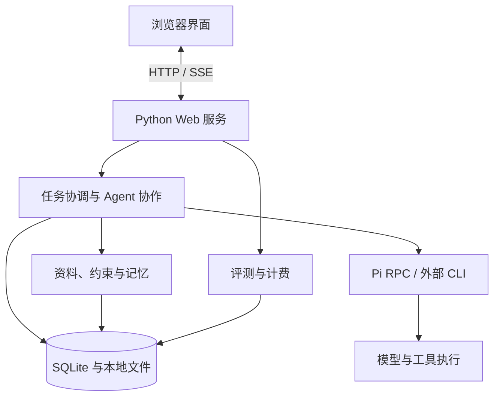

# Pi Agent Workbench

我希望在把任务交给 Agent 之后，仍然能看清整个过程：它现在做到了哪一步，调用过什么工具，为什么需要我介入，最后交付了什么。

这个工作台围绕这些问题，把 Pi 的任务执行接到本地 Web 界面中，串起任务管理、Agent 协作、执行轨迹、上下文和评测。

[架构](#架构) · [任务中心](#任务中心) · [执行轨迹](#执行轨迹) · [评测报告](#评测报告)

## 架构

Python 负责任务协调、审批和事件持久化，Pi 承担模型与工具执行。上下文、模型接入和评测分别放在 `context/`、`models/`、`ops/`；前端使用原生 JavaScript 和 CSS，通过 SSE 接收执行进度。

## 任务中心

多个任务同时推进时，进度、提问和交付容易分散在不同记录里。工作台按“待开始、执行中、需处理、已完成”组织任务，在卡片上呈现进度、子 Agent 和文件变化。

任务的执行状态与需要人工介入的位置因此集中到一处，打开卡片就能接着查看过程、处理审批或补充要求。

## 执行轨迹

长任务里的模型响应、工具调用和审批等待交错发生，单看最终回复很难还原过程。工作台把这些事件与记忆组装放到同一条时间轴上，记录开始位置、耗时和关联信息，并支持按 Agent 与执行轮次查看。

从轨迹中可以看清时间花在了哪里，再展开具体记录核对参数、工具结果和来源，追踪任务是怎样走到当前状态的。

## Agent 协作

任务被拆给多个 Agent 后，分工、并行关系和汇总过程需要清楚呈现。工作台根据执行事件生成流程图，把主 Agent 的调度、子 Agent 的执行以及结果汇总连接起来，同时提供调查、执行、审查和测试等角色配置。

协作关系可以直接在图中查看，选择节点即可回到相应记录，核对每个 Agent 承担的任务和返回的结果。

## 上下文与记忆

随着任务推进，目标、约束、资料和中间决定会不断增加。工作台将用户约束与 Agent 工作笔记分别保存，记录每次上下文组装快照，并提供文档页、文本块和聊天消息的显式交接。

任务要求有了清楚的归属，调用前使用的记忆可以回看，较长的工具结果也能通过外置原文按需取回，便于持续核对任务依据。

## 评测报告

任务结束后，交付质量、执行消耗和失败情况需要放在一起看。独立评测页面汇总业务审阅、请求次数、执行步数、工具调用、错误、工具成功率、估算金额和策略拦截，并按任务排列比较。

同一张报告可以同时查看任务结果和运行代价。DeepSeek 账户区还提供官方余额查询，任务表统一显示一个估算金额，计价依据随任务保留。

## 逐项评测

一个总评很难说明具体要求完成到了什么程度。工作台将业务审阅拆成分项结论和判定理由，与交付记录、运行检查、工具结果统计和计价依据放在同一个任务视图中。

查看任务时，可以从整体结论读到具体检查项，再进入任务轨迹核对执行记录，让每次交付的评价都有可继续查阅的依据。

