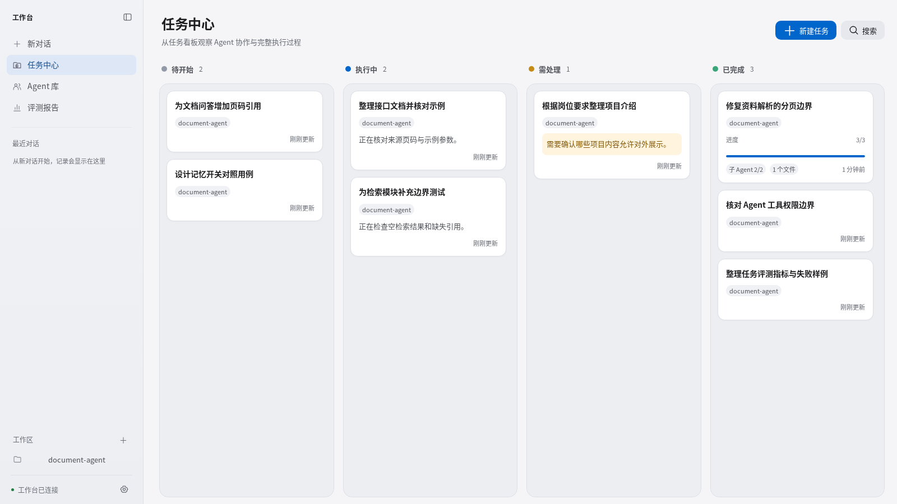
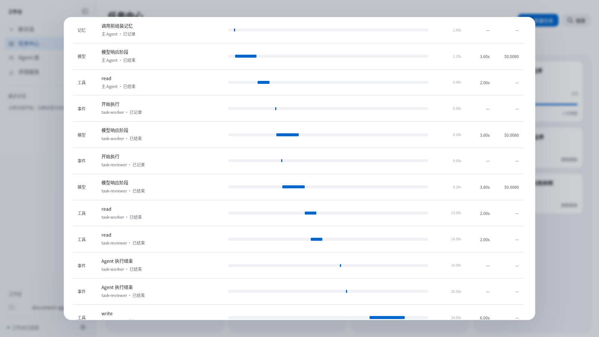
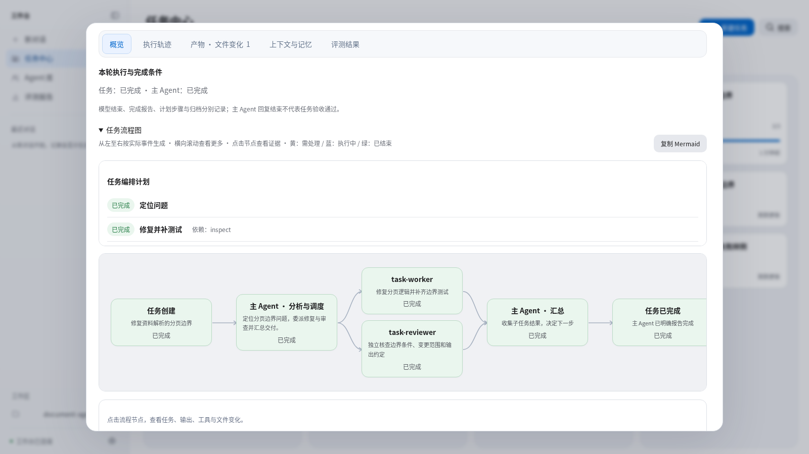
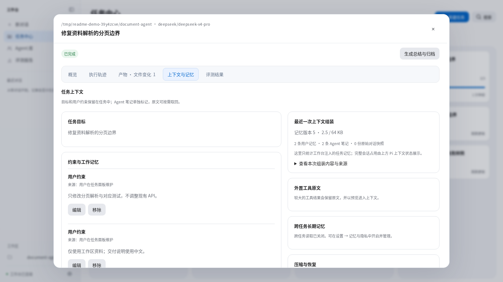
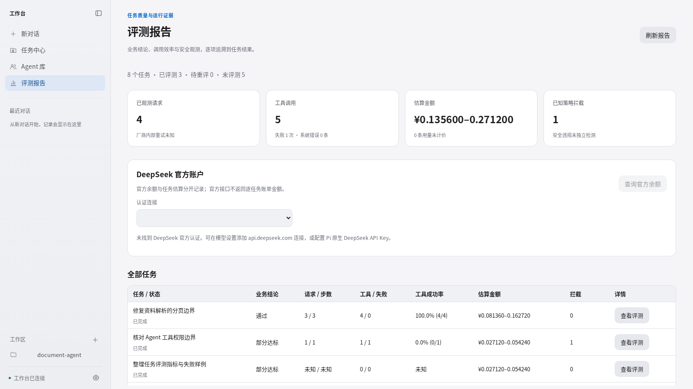
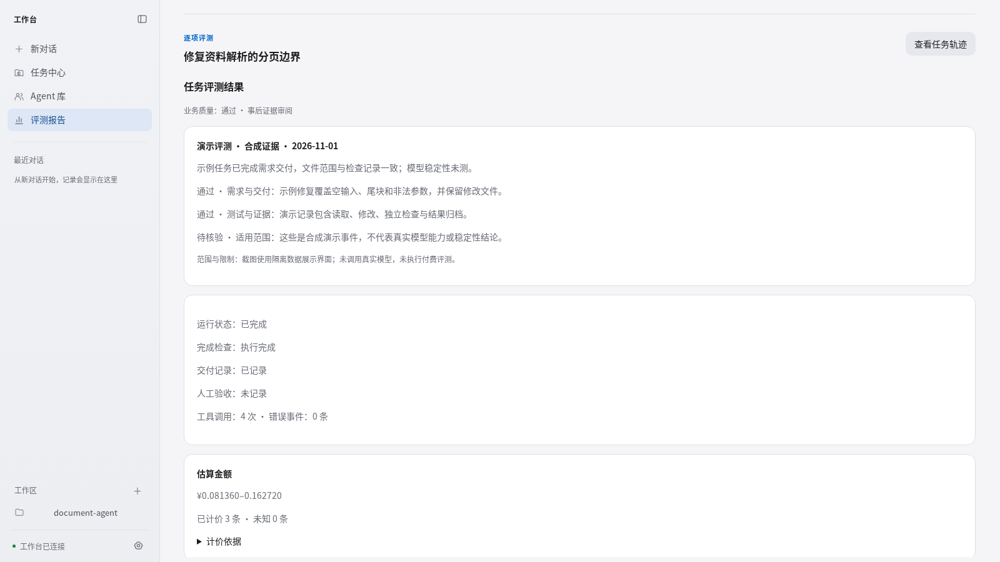

# Pi Agent Workbench

我希望在把任务交给 Agent 之后，仍然能看清整个过程：它现在做到了哪一步，调用过什么工具，为什么需要我介入，最后交付了什么。

这个工作台就是围绕这些问题做的。它把 Pi 的任务执行接到一个本地 Web 界面里，提供任务看板、对话、多 Agent 协作、执行轨迹、上下文管理和评测报告。Python 负责协调与持久化，Pi 负责模型和工具执行，浏览器负责把过程展示出来。

如果你也想观察 Agent 如何完成一件事，或者正在研究工具、上下文和评测怎样配合，希望这个项目能提供一个可以运行、可以追踪的例子。

[快速开始](#快速开始) · [界面与使用方式](#界面与使用方式) · [代码结构](#代码结构) · [运行验证](#运行验证) · [当前进展](#当前进展与边界)

### 先从任务中心看起

任务按“待开始、执行中、需处理、已完成”排列。一个任务的进度、子 Agent 数量和文件变化可以在卡片上看到，点进去再看具体过程。

我希望“需处理”是一个有用的入口：缺了资料、需要审批、执行中断，都应该有明确提示，让人知道下一步该做什么。



新建任务时可以选择工作区、模型和执行器。普通讨论留在对话里，需要真正操作文件或分派子任务时，再转入任务流程。任务支持停止、补充要求和继续执行。

### 展开轨迹，看看时间花在哪里

任务详情默认打开执行轨迹。模型响应、工具调用、记忆组装和审批等待放在一条时间轴上，方便找到耗时的位置，以及失败发生前的上下文。

点开一条记录，可以继续查看已采集的参数、结果和关联信息；可以按 Agent 和执行轮次查看任务记录；对话轨迹还支持事件类型筛选，避免长任务的记录混在一起。



这里展示的是可观察的执行事件。缺少开始时间、用量或价格信息时会保留未知状态，不补造完整记录。模型调用结束也不会自动等同于业务验收通过。

### 看清主 Agent 和子 Agent 如何协作

概览里的流程图根据实际事件生成，可以看到主 Agent 的分析、委派、子 Agent 执行和汇总过程。点击节点能查看相应记录，遇到中断时也能沿着流程回到问题所在。

目前支持一层子 Agent 委派，以及同一批次内的并行执行。内置角色包括调查、执行、审查和测试，也可以在 Agent 库中修改角色提示词、可用工具和模型。



角色拆分提供了观察和控制协作的方式；它是否提高任务质量，仍然需要在相同任务与预算下验证。

### 把目标、约束和资料放在能找回的地方

任务过程中经常会积累新的要求和决定。我希望这些内容有明确归属，也能在后续调用前检查到底注入了哪些信息。

“上下文与记忆”保存任务目标、用户约束和 Agent 工作笔记，并记录最近的组装快照。用户约束与 Agent 笔记分别展示；长期记忆的读取、写入和清理可以独立控制。



资料入口支持文字型 PDF、DOCX 和 Markdown。创建任务时，可以选择聊天消息、文档页或文本块，预览准备交接的内容与初始预算。较长的工具结果可以外置保存，再按需要取回原文。

目前的初始预算使用保守的字节检查，不是全执行循环的精确 Token 预算。扫描件 OCR 和语义检索还没有实现。

### 任务结束后，再看效果与代价

评测报告是独立页面。上方汇总请求、工具调用、估算金额和策略拦截，下方按任务对比运行状态、业务结论、步数、工具成功率和费用。

我更关心一份结论能解释到什么程度，所以页面把“执行完成”和“业务评测”分开，也保留缺证据、未评测和待重评的情况。



| 信息 | 看它是为了什么 |
| --- | --- |
| 业务结论与分项理由 | 检查需求是否满足、交付是否完整、依据是否充分 |
| 请求次数与步数 | 观察已采集的模型调用和执行轮次 |
| 工具调用、失败与成功率 | 检查工具执行结果，并保留未知或未返回的结果 |
| 系统错误 | 定位运行问题，和工具失败分别记录 |
| 估算金额与未知部分 | 了解成本及计价覆盖范围 |
| 策略拦截与审批拒绝 | 查看已记录的边界控制，不能据此认定没有安全违规 |
| 重复成功率与方差 | 仅在有同条件独立重复样本时计算；当前不足则明确提示 |

点击“查看评测”，同一页面会展开所选任务的分项结论、理由、运行检查和计价依据，也能回到任务轨迹继续核对。



当前的业务审阅来自已保存的事后证据检查，并不是每个任务都会自动得到模型裁判评分。任务出现新的执行事件后，旧结论会标为“待重评”。

DeepSeek 官方账户区支持手动查询可用余额、充值余额和赠金。任务只显示一个“估算金额”：优先使用可用的官方人民币价格快照，否则回退已有模型估算并注明币种。余额属于账户，不能通过余额差认定单个任务的实际扣费。

## 快速开始

目前主要在 **WSL/Linux 桌面浏览器**下使用和验证。需要：

- Python 3.11 或更新版本。
- 已安装且能正常运行的 Pi，当前验证基线为 1.3.0。
- 一个可用的模型连接。模型授权可在 Pi 中完成，也可以使用工作台的 API 连接设置。

前端使用原生 JavaScript 和 CSS，日常运行不需要 Node.js 或前端构建。PDF 文字提取依赖 `pypdf`，DOCX 和 Markdown 解析使用内置实现。

```bash
git clone https://github.com/xinyking/pi-agent-workbench-demo.git
cd pi-agent-workbench-demo

python3 -m venv .venv
source .venv/bin/activate
python -m pip install 'pypdf>=6,<7'

pi --version
./run.sh --port 4310
```

打开 [http://localhost:4310](http://localhost:4310)，在设置中添加一个已有项目目录，检查 Pi 环境并选择模型。

Pi 不在 PATH 时，可以指定程序路径：

```bash
WORKBENCH_PI=/path/to/pi ./run.sh --port 4310
```

默认本地数据保存在 `.workbench/`。如果要同时运行多个实例，请分别指定端口和数据库，不要让多个服务共用同一个数据目录：

```bash
./run.sh --port 4312 --data .workbench-test/state.sqlite3
```

`.env.example` 列出了可选环境变量。工作台不会自动解析 `.env` 文件，需要先将变量加载到启动服务的 Shell 中。

### 第一次可以这样试

找一个可用于试验的小项目，给出边界明确的任务，例如：

```text
请检查 parser.py 的分页逻辑，修复空输入和最后不足一页的处理。
只修改相关代码和测试，不调整现有 API。
先调查现状，再执行修复，最后核对结果并说明验证范围。
```

在界面中可以依次：

1. 选择工作区，写明目标和限制；有参考资料时勾选需要交接的内容。
2. 创建并启动任务，查看主 Agent 如何处理，是否需要分派子任务。
3. 在“需处理”中回答问题，或对文件修改、命令请求作出审批。
4. 查看轨迹、结果和文件变化，必要时补充要求继续执行。
5. 打开评测报告，核对已有评测、运行指标和估算金额。

真实任务可能产生模型费用。截图和离线测试均使用演示数据，不需要用自己的资料复现它们。

## 代码结构

项目规模还不大，保留了 Python 标准库 HTTP 服务、SQLite 和原生前端，方便沿着一次请求从页面读到执行层。

```text
workbench/
  __main__.py           服务入口
  runtime.py            任务执行、委派、审批与状态协调
  store.py              SQLite 与事件记录
  conversations.py      普通对话与任务交接
  context/              任务上下文、约束、来源与记忆
  models/               Pi 连接、模型目录与 API 设置
  ops/                  评测、用量、计费与交付归档
  web/                  HTTP 路由与 SSE
  pi/                   Pi 扩展和工具桥接
  static/
    index.html
    js/                 页面控制器与视图逻辑
    css/                界面样式
    vendor/             随项目分发的前端依赖

.pi/agents/             内置角色定义
skills/task-board/      供其他工具调用的接入技能与脚本
evals/                  隔离用例与独立评分器
tests/                  Python / JavaScript 回归和离线样本
scripts/                评测与浏览器验证入口
assets/demo/            README 演示截图
```

如果准备读代码，可以先看 `web/` 中的路由，再看 `runtime.py` 的执行与事件处理。页面从 `static/js/app.js` 组装，任务详情、对话和评测各有对应模块。

模块划分参考了 [Waku](https://github.com/shenseanchen/waku-agent) 对运行、记忆和运维职责的组织。Agent 执行使用 Pi RPC，前端通过 HTTP 与 SSE 读取状态和接收更新。

## 运行验证

普通回归需要 Python 和 Node.js：

```bash
make test
# 也可以分别运行
make test-python
make test-js
```

部分集成测试依赖额外环境，缺少时会跳过。已安装 Pi 时，可显式运行本地离线 Provider 测试，覆盖工具循环、委派和审批等流程：

```bash
WORKBENCH_TEST_REAL_PI=1 make test-python
```

浏览器验证会创建临时工作区和数据库，再实际操作页面：

```bash
python -m pip install playwright
python -m playwright install chromium
python scripts/verify_ui.py --desktop-only
```

Chromium 需要相应系统依赖。验证截图和日志写入本机 `artifacts/`，不进入仓库中的运行数据目录。

### 离线评测

`scripts/run_evals.py` 是基础入口，默认只列计划。可选的 DeepEval 评分使用单独环境：

```bash
python3 -m venv .venv-evals
.venv-evals/bin/pip install -r evals/requirements.lock

.venv-evals/bin/python scripts/run_deepeval.py --mode offline --judge contract \
  --output artifacts/evals/local-check
```

输出目录必须不存在。`contract` 使用合成裁判验证评分协议；它能检查流程和硬门禁是否工作，不能证明真实模型的语义评分正确。`scripts/compare_pi_evals.py` 还提供相同证据上的原生确定性评分器比较，运行依赖位于 `evals/pi_official/`。

我希望逐步补上可复现的真实模型对照，但现阶段不会把离线通过率包装成系统效果提升。

## 当前进展与边界

任务、对话、资料选择、上下文与记忆、执行轨迹、评测报告，以及可选外部执行器入口已经具备。Codex / Claude CLI 需要使用者另行安装并完成授权。

这个项目仍面向个人本机使用。文件修改和命令执行经过工作台审批，Shell 使用当前用户权限，项目目录不等同于操作系统沙箱。建议从一个可备份、范围清楚的工作区开始。

接下来更值得投入的地方是长任务恢复、历史事件分页、评测证据定位，以及同任务、同模型、同预算下的质量与成本对照。OCR、语义检索和独立安全违规检测也仍有缺口。

如果你准备基于它继续开发，欢迎先从一个具体任务出发：找出难以观察或控制的一步，再把需要的事件、交互和验证补齐。
